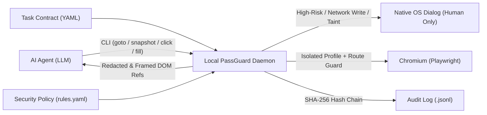

# PassGuard Web Agent

> **Speed of DOM refs, with security the model can't talk its way around.**

PassGuard Web Agent is an AI Agent Skill and local browser security proxy built on Playwright. It solves the two biggest real-world barriers to web-task agents:
1. **Slow & brittle screen control**: Replaces slow screenshot-and-coordinate loops with lightweight DOM element references (`@e1`, `@e2`, ...) and deterministic recipe replay.
2. **Unsafe credentials & prompt-level "honor system" security**: Enforces hard, code-level guardrails inside a local browser daemon—with **out-of-band native human confirmation** that neither the LLM nor malicious website JavaScript can forge or bypass.

---

## How PassGuard Differs from Similar Skills

| Capability | Typical Browser Skills (`agent-browser`, `playwright-cli`, `browser-use`) | **PassGuard Web Agent** |
| :--- | :--- | :--- |
| **Element targeting** | Compact DOM / accessibility refs (`@e1`) | Compact DOM refs (`@e1`) + deterministic recipe replay |
| **Password handling** | Relies on prompt rules ("don't ask for passwords") | **Hard circuit breaker**: password fields stripped from snapshots & blocked in `fill` |
| **High-risk approval** | Model decides or passes a CLI flag | **Out-of-Band (OOB) native OS dialog** (`tkinter`), zero CLI bypass flag |
| **Write protection** | Button-text heuristics only | **Effect-based network gate**: intercepts `POST`/`PUT`/`PATCH`/`DELETE` before send |
| **Session scoping** | Unbounded once logged in | **OAuth-style Task Contracts** (allowed actions, write budget, TTL, `--ephemeral`) |
| **Prompt injection** | Raw DOM / text passed to LLM | Filters hidden/tiny/same-color text, detects injection phrases, wraps `<untrusted_web_content>` |
| **Data exfiltration** | None | **Cross-domain taint tracking** blocks leaking PII read on Site A into Site B forms |
| **Auditability** | Plain stdout / debug logs | **SHA-256 hash-chained JSONL audit log** with `verify-log` integrity check |

---

## Architecture



---

## Core Security & Speed Features

1. **Out-of-Band (OOB) Human Confirmation (`scripts/oob_confirm.py`)**
   - There is **no** `--confirm-risk` CLI flag. High-risk clicks and network write requests pop up a native always-on-top OS dialog (`tkinter`) outside both the browser DOM and the LLM's CLI channel. If no GUI display is available, it fails closed (denies).
2. **Effect-Based Write Interception**
   - Even if a deceptive button is labeled `"Continue"` instead of `"Pay"`, PassGuard intercepts the underlying `POST` / `PUT` / `PATCH` / `DELETE` request in `_route_guard`, displays the method, URL, and redacted body preview to the user, and blocks the request unless approved.
3. **OAuth-Style Task Contracts (`contracts/`)**
   - Scope a session with a YAML contract (`allow`, `domains`, `max_write_requests`, `expires_in_seconds`, `ephemeral`). When the write budget is exhausted or TTL expires, the daemon locks down automatically.
4. **Zero-Credential Password Circuit Breaker**
   - `input[type="password"]` and `autocomplete="*password*"` fields are omitted from `snapshot` and double-checked live in DOM before `fill`. Login pages return exit code `3` (`LOGIN_REQUIRED`) so you log in manually in the visible browser window.
5. **Anti-Prompt-Injection Filtering & Framing**
   - `SNAPSHOT_JS` and `VISIBLE_TEXT_JS` strip zero-size, `display:none`, `visibility:hidden`, low-opacity, tiny-font (`<2px`), off-screen, and same-color-as-background elements. Extracted output is scanned for injection patterns and wrapped in `<untrusted_web_content>`.
6. **Cross-Domain Taint Tracking**
   - Sensitive data (emails, phone numbers, ID/card-like numbers) observed on Origin A is tracked in `TaintTracker`. Attempting to `fill` that data into Origin B triggers a cross-domain exfiltration block/OOB check.
7. **Tamper-Evident Hash-Chain Audit Log (`scripts/audit.py`)**
   - Every session event, blocked request, and OOB decision is redacted and appended to `~/.passguard-web-agent/logs/<profile>.jsonl` with a rolling SHA-256 hash chain (`verify-log`).
8. **Ephemeral Hygiene & Site Memory Replay**
   - Use `--ephemeral` for sensitive tasks to wipe the isolated browser profile directory on `stop`.
   - Use `save-recipe` and `replay` to run verified multi-step workflows deterministically without per-step LLM inference—while keeping every security gate enforced.

---

## Quick Start

```bash
pip install -r requirements.txt
playwright install chromium
```

### 1. Read-Only Research Session (Scoped Contract)

```bash
python scripts/safe_browser.py start --profile research --contract contracts/readonly-research.yaml
python scripts/safe_browser.py goto https://github.com --profile research
python scripts/safe_browser.py snapshot --profile research
python scripts/safe_browser.py text --profile research
python scripts/safe_browser.py stop --profile research
python scripts/safe_browser.py verify-log --profile research
```

### 2. Ephemeral Sensitive Workflow

```bash
python scripts/safe_browser.py start --profile banking --allow-domains bank.example.com --ephemeral --ttl 900
python scripts/safe_browser.py goto https://bank.example.com --profile banking
# If login page appears, log in manually in the visible browser window, then:
python scripts/safe_browser.py snapshot --profile banking
python scripts/safe_browser.py stop --profile banking   # Automatically wipes profile directory
```

---

## Project Structure

```text
passguard-web-agent/
├── SKILL.md                          # Agent skill instructions & workflow
├── rules.yaml                        # Keywords, login patterns, redaction, injection & taint rules
├── requirements.txt
├── contracts/
│   ├── readonly-research.yaml        # Example: read-only research contract
│   └── safe-form-fill.yaml           # Example: single-write ephemeral contract
├── scripts/
│   ├── safe_browser.py               # Playwright security proxy CLI & local session daemon
│   ├── security.py                   # Policy, TaskContract, TaintTracker, anti-injection & redaction
│   ├── audit.py                      # SHA-256 hash-chained audit logger & verifier
│   └── oob_confirm.py                # Out-of-band native OS confirmation dialog
└── tests/
    ├── test_security.py              # Policy, redaction, injection & taint tests
    └── test_audit_and_contract.py    # Contract TTL/budget & hash-chain tamper detection tests
```

## Running Tests

```bash
python -m unittest discover -s tests -v
```

---

## Threat Model & Honest Limitations

- **What PassGuard stops**: Accidental or prompt-injected password leakage to LLMs, self-approved dangerous clicks, silent background `POST`/`DELETE` requests, hidden-text prompt injections, cross-site PII exfiltration, and unverified log tampering.
- **What PassGuard assumes**: The local host OS and Python runtime are trusted; the user runs the visible browser locally when OOB native confirmation or manual login is required.
