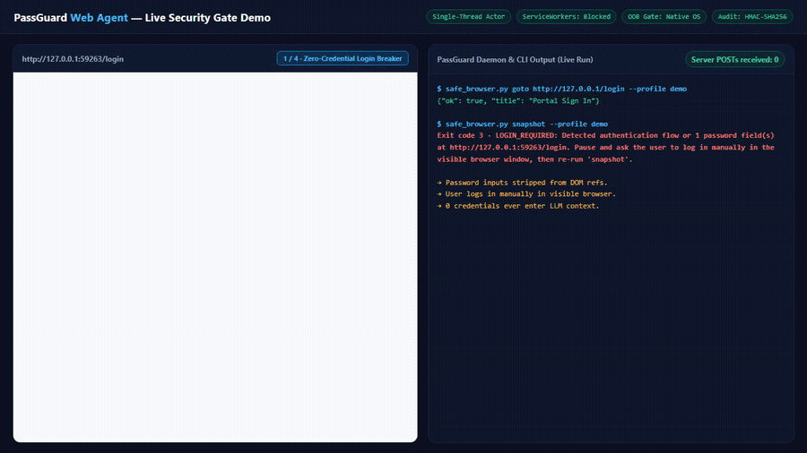

# PassGuard Web Agent

**English** | [简体中文](README.zh-CN.md)

[](https://github.com/haoranyoung09-sys/passguard-web-agent/actions/workflows/ci.yml)
[](LICENSE)
[](pyproject.toml)

> **DOM element refs with defense-in-depth browser guardrails — human-in-the-loop authentication, out-of-band OS confirmation, effect-based write interception, and verifiable audit logs.**



*Watch the high-res MP4 demo: [`assets/demo.mp4`](assets/demo.mp4) (recorded with [`bench/record_demo.py`](bench/record_demo.py)) · Static diagram: [`assets/demo.svg`](assets/demo.svg).*

PassGuard Web Agent is an AI Agent Skill, local browser security proxy, and stdio MCP server built on Playwright. It replaces coordinate-based screenshot loops with lightweight DOM element references (`@e1`, `@e2`, ...) while enforcing code-level guardrails inside a single-thread Playwright daemon.

---

## Install in 30 Seconds

### Option A: As an Agent Skill
```bash
git clone https://github.com/haoranyoung09-sys/passguard-web-agent.git
cd passguard-web-agent
pip install -r requirements.txt
playwright install chromium
```
Or install directly with the Skills CLI (if supported by your client):
```bash
npx skills add haoranyoung09-sys/passguard-web-agent
```

### Option B: As an MCP Server (Claude Desktop / Cursor / Antigravity)
Add this to your MCP config (`mcpServers`):
```json
{
  "passguard-web-agent": {
    "command": "python",
    "args": ["/path/to/passguard-web-agent/scripts/mcp_server.py"]
  }
}
```

---

## Key Security & Engineering Features

1. **Dedicated Single-Thread Playwright Actor (`scripts/safe_browser.py`)**
   - All Playwright operations execute serially inside one dedicated worker thread via a task queue, preventing greenlet cross-thread failures behind `ThreadingHTTPServer`.
2. **Out-of-Band (OOB) Human Confirmation (`scripts/oob_confirm.py`)**
   - There is **no** `--confirm-risk` CLI flag. High-risk clicks, write requests, and cross-domain data transfers trigger a native always-on-top OS dialog (`tkinter`) outside both the browser DOM and the LLM CLI channel. Fails closed (denies) on headless systems without a display.
3. **Full-Resource Allowlist & Service Worker Blocking**
   - Launches Chromium with `service_workers="block"`.
   - Enforces `--allow-domains` across **all** resource types (documents, XHR/fetch, images, scripts, `ping`/`sendBeacon`, and WebSockets), closing `` and beacon exfiltration channels.
4. **Effect-Based Write Interception + Smart Mode**
   - Intercepts `POST`, `PUT`, `PATCH`, `DELETE`, `ping`, and WebSocket requests in `_route_guard`, summarizing JSON/form fields in human-readable form before approval.
   - Supports `confirm_writes_mode`: `strict` (prompt all writes), `smart` (auto-allow known telemetry paths in `rules.yaml` while still respecting write budgets), or `none`.
5. **TOCTOU Click Defense & Multi-Frame / Shadow DOM Snapshots**
   - Invalidates stale refs on navigation and re-reads live element attributes (`innerText`, `aria-label`, `title`, `type`) immediately before clicking.
   - Scans `page.frames` and open `shadowRoot`s, filtering `display:none`, `visibility:hidden`, low-opacity, `<2px` font, off-screen, and ancestor-same-color hidden text.
6. **Zero-Credential Password Circuit Breaker**
   - Password fields (`input[type="password"]`, `autocomplete="*password*"`) are stripped from snapshots and blocked in `fill` (verified live in DOM). Login URLs (`path`-boundary matched) and OTP/QR/Passkey pages return exit code `3` (`LOGIN_REQUIRED`) for manual user login.
7. **Cross-Domain Taint Tracking**
   - Sensitive data (emails, phone numbers, ID/card-like numbers) observed on Site A is tracked across `fill`, URL query strings, and request bodies (checking raw, URL-decoded, and Base64 variants).
8. **HMAC-SHA256 / SHA-256 Audit Logs (`scripts/audit.py`)**
   - Records every action and block decision (redacted) in `~/.passguard-web-agent/logs/<profile>.jsonl`.
   - Set `PASSGUARD_AUDIT_KEY` (or `--key-file` on `verify-log --require-hmac`) stored outside the agent's access for cryptographic tamper resistance. Without an external key, the unkeyed SHA-256 chain detects accidental corruption only.
9. **MCP Server (`scripts/mcp_server.py`) & PassGuard Bench (`bench/run_bench.py`)**
   - Stdio JSON-RPC 2.0 MCP server (`passguard_start`, `passguard_goto`, `passguard_snapshot`, `passguard_click`, `passguard_fill`, `passguard_text`, `passguard_stop`) enabling privilege-separated deployment where the agent has no shell access.
   - Local adversarial benchmark (`bench/run_bench.py`) testing hidden-text injection, deceptive `POST` buttons, `sendBeacon`, `` leaks, login traps, and verified ephemeral cleanup.

---

## Ready-to-Use Task Contract Templates (`contracts/`)

- [`contracts/readonly-research.yaml`](contracts/readonly-research.yaml) — Read-only web research (`max_write_requests: 0`, 30m TTL).
- [`contracts/ecommerce-readonly.yaml`](contracts/ecommerce-readonly.yaml) — Price comparison & order lookup with separate `asset_domains` for static CDNs and zero writes allowed.
- [`contracts/admin-draft-single-write.yaml`](contracts/admin-draft-single-write.yaml) — Back-office form filling capped at `1` OOB-confirmed write request with `--ephemeral` profile wipe on exit.

---

## Honest Threat Model & Deployment Boundaries

> [!IMPORTANT]
> **Same-Privilege Limitation**: If you run the AI agent under the **same OS user** with unrestricted shell/filesystem access, the agent could theoretically read local profile directories, alter `rules.yaml`, or kill the daemon directly.
>
> **How to achieve true non-bypassable isolation**: Run `safe_browser.py` / `mcp_server.py` under a **dedicated OS user or container** that owns `~/.passguard-web-agent/` and `PASSGUARD_AUDIT_KEY`, and expose **only** the MCP stdio pipe or RPC socket to the agent (without shell access).

- **Prompt injection heuristics**: Regex scanning (after NFKC normalization and zero-width stripping) is advisory defense-in-depth; primary protection comes from `<untrusted_web_content>` framing plus deterministic code-level gates.

---

## Running Tests & Adversarial Bench

```bash
# Pure-Python unit tests (13 checks, no browser required)
python -m unittest discover -s tests -v

# End-to-end adversarial Chromium benchmark (6 checks, requires Playwright + Chromium)
python bench/run_bench.py
```

Latest verified `PassGuard Bench` run:
```text
[1/6] Starting BrowserController...
[2/6] Navigating to adversarial fixture...
[3/6] Checking hidden-text injection stripping...
[4/6] Taking snapshot & testing deceptive POST /api/pay...
[5/6] Testing sendBeacon block & password circuit breaker...
[6/6] Closing controller & verifying ephemeral cleanup...
PassGuard Bench: ALL 6 E2E ADVERSARIAL CHECKS PASSED.
```
