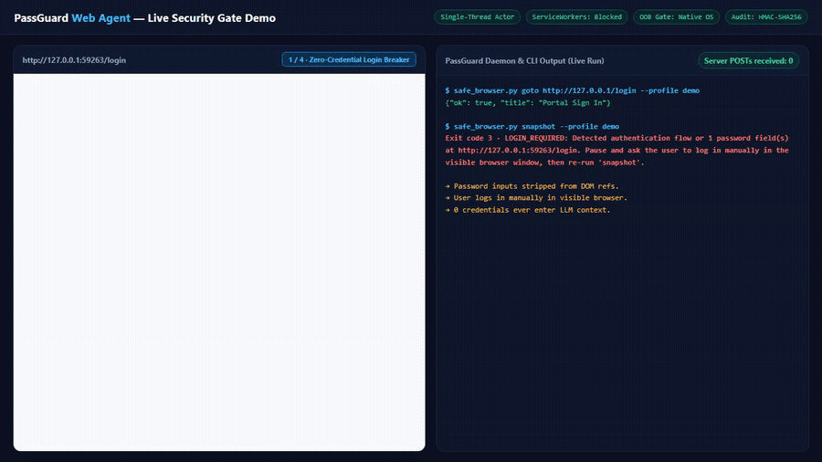

# PassGuard Web Agent

[English](README.md) | **简体中文**

[](https://github.com/haoranyoung09-sys/passguard-web-agent/actions/workflows/ci.yml)
[](LICENSE)
[](pyproject.toml)

> **兼具 DOM 元素引用的操作效率与纵深防御的浏览器安全护栏 —— 人工接力登录、带外原生弹窗确认、按请求效果拦截写入、以及可校验的审计日志。**



*高清 MP4 演示视频：[`assets/demo.mp4`](assets/demo.mp4)（由 [`bench/record_demo.py`](bench/record_demo.py) 真实录制） · 静态架构图：[`assets/demo.svg`](assets/demo.svg)。*

PassGuard Web Agent 是一个基于 Playwright 构建的 **AI Agent Skill**、**本地浏览器安全代理**与 **stdio MCP Server**。它用轻量级 DOM 元素引用（`@e1`、`@e2`...）替代缓慢脆弱的截屏坐标点击，同时在单线程 Playwright 守护进程内部强制执行代码级安全护栏。

---

## 30 秒快速安装

### 方式 A：作为 Agent Skill 使用
```bash
git clone https://github.com/haoranyoung09-sys/passguard-web-agent.git
cd passguard-web-agent
pip install -r requirements.txt
playwright install chromium
```
或通过 Skills CLI 直接安装（若你的客户端支持）：
```bash
npx skills add haoranyoung09-sys/passguard-web-agent
```

### 方式 B：作为 MCP Server 使用（Claude Desktop / Cursor / Antigravity）
将以下配置加入你的 MCP 配置文件（`mcpServers`）：
```json
{
  "passguard-web-agent": {
    "command": "python",
    "args": ["/path/to/passguard-web-agent/scripts/mcp_server.py"]
  }
}
```

---

## 核心安全与工程特性

1. **单线程 Playwright Actor 执行模型（`scripts/safe_browser.py`）**
   - 所有 Playwright 生命周期与页面操作均通过任务队列串行调度到同一条专用工作线程执行，彻底避免 `ThreadingHTTPServer` 多线程并发引发的 greenlet 跨线程报错。
2. **带外（OOB）原生人工确认（`scripts/oob_confirm.py`）**
   - 代码中**不存在** `--confirm-risk` 这类可供模型自行传递的绕过参数。高危点击、写请求与跨站敏感数据填充会直接弹出置顶的系统原生 `tkinter` 确认框，独立于网页 DOM 和 LLM CLI 通道之外；无图形界面时默认 Fail-Closed（拒绝）。
3. **全资源类型域名白名单 & 禁用 Service Worker**
   - 启动 Chromium 时强制设置 `service_workers="block"`。
   - `--allow-domains` 拦截范围覆盖**全部资源类型**（页面文档、XHR/fetch、图片、脚本、`ping`/`sendBeacon` 与 WebSocket），封堵 `` 与信标外泄通道（静态 CDN 可通过 `asset_domains` 单独放行）。
4. **按“实际效果”拦截写请求 + 智能模式**
   - 在 `_route_guard` 中拦截所有 `POST`、`PUT`、`PATCH`、`DELETE`、`ping` 与 WebSocket 请求，先将 JSON/表单请求体整理为可读字段摘要并脱敏，经人工批准后才放行。
   - 支持 `confirm_writes_mode`：`strict`（全部写入弹窗确认）、`smart`（自动放行 `rules.yaml` 中配置的良性遥测接口，但仍受写入配额限制）或 `none`。
5. **TOCTOU 点击实时复核 & 多 Frame / Shadow DOM 快照**
   - 页面导航后自动清空旧的 `@eN` 引用；每次点击前会再次实时读取 DOM 元素的 `innerText`、`aria-label`、`title` 与 `type` 复核高危关键词。
   - 遍历 `page.frames` 与开放 `shadowRoot`，并沿祖先节点计算真实背景色，过滤 `display:none`、`visibility:hidden`、极低透明度、极小字号（`<2px`）、屏幕外及与背景同色的隐藏文本。
6. **零凭证密码框熔断器**
   - `input[type="password"]` 及 `autocomplete="*password*"` 元素会从快照中剔除，并在 `fill` 时通过实时 DOM 校验拒绝填充。遇到登录 URL（路径段边界匹配）或 OTP/扫码/Passkey 页面时返回退出码 `3`（`LOGIN_REQUIRED`），暂停交由用户在可见浏览器窗口手动登录。
7. **跨站污点追踪（防数据外泄）**
   - 记录从站点 A 提取的邮箱、手机号、证件号等敏感信息，在 `fill`、URL 查询参数及请求体中校验原始值、URL 解码及 Base64 编码变体，拦截向非同主站站点 B 的外传尝试。
8. **HMAC-SHA256 / SHA-256 审计日志（`scripts/audit.py`）**
   - 所有操作与拦截记录经脱敏后追加写入 `~/.passguard-web-agent/logs/<profile>.jsonl`。
   - 将密钥存入 Agent 无法读取的外部环境（`PASSGUARD_AUDIT_KEY` 或 `verify-log --key-file --require-hmac`）即可启用防重算的 HMAC-SHA256 校验；未提供外部密钥时，无密钥 SHA-256 链仅用于检测意外损坏。
9. **MCP Server（`scripts/mcp_server.py`）与对抗靶场 PassGuard Bench（`bench/run_bench.py`）**
   - 提供标准 stdio JSON-RPC 2.0 MCP 服务（`passguard_start` / `goto` / `snapshot` / `click` / `fill` / `text` / `stop`），方便做无 Shell 权限的隔离部署。
   - 内置本地对抗测试集 `bench/run_bench.py`，实测隐藏注入过滤、伪装为 `Continue` 的 `POST` 扣款按钮、`sendBeacon`、`` 泄露、登录页熔断及用完即焚清理。

---

## 开箱即用的任务契约模板（`contracts/`）

- [`contracts/readonly-research.yaml`](contracts/readonly-research.yaml) — 只读调研模板（`max_write_requests: 0`，30 分钟过期）。
- [`contracts/ecommerce-readonly.yaml`](contracts/ecommerce-readonly.yaml) — 电商比价与查单只读模板（通过 `asset_domains` 放行静态 CDN，禁止任何写操作）。
- [`contracts/admin-draft-single-write.yaml`](contracts/admin-draft-single-write.yaml) — 后台填表模板（最多允许 `1` 次经 OOB 确认的写请求，退出时 `--ephemeral` 自动销毁 Profile）。

---

## 诚实的威胁模型与部署边界

> [!IMPORTANT]
> **同权限局限性**：如果你让 AI Agent 运行在**同一个操作系统用户**下且拥有不受限的 Shell/文件读写权限，Agent 理论上可以直接读取本地 Profile 目录、修改 `rules.yaml` 或直接终止守护进程。
>
> **如何实现真正不可绕过的隔离**：将 `safe_browser.py` / `mcp_server.py` 运行在**独立的系统用户或容器**中（由该独立账户持有 `~/.passguard-web-agent/` 与 `PASSGUARD_AUDIT_KEY`），只向 Agent 暴露 MCP stdio 管道或 RPC 接口，不赋予其 Shell 权限。

- **提示注入检测**：经 NFKC 归一化与零宽字符剥离后的正则扫描属于辅助纵深防御；真正可靠的防护来自 `<untrusted_web_content>` 上下文隔离标签与代码级硬拦截门禁。

---

## 运行单元测试与对抗靶场

```bash
# 纯 Python 单元测试（13 项检查，无需启动浏览器）
python -m unittest discover -s tests -v

# 真实 Chromium 端到端对抗基准测试（6 项检查，需先安装 Playwright + Chromium）
python bench/run_bench.py
```

最近一次实测 `PassGuard Bench` 输出：
```text
[1/6] Starting BrowserController...
[2/6] Navigating to adversarial fixture...
[3/6] Checking hidden-text injection stripping...
[4/6] Taking snapshot & testing deceptive POST /api/pay...
[5/6] Testing sendBeacon block & password circuit breaker...
[6/6] Closing controller & verifying ephemeral cleanup...
PassGuard Bench: ALL 6 E2E ADVERSARIAL CHECKS PASSED.
```
